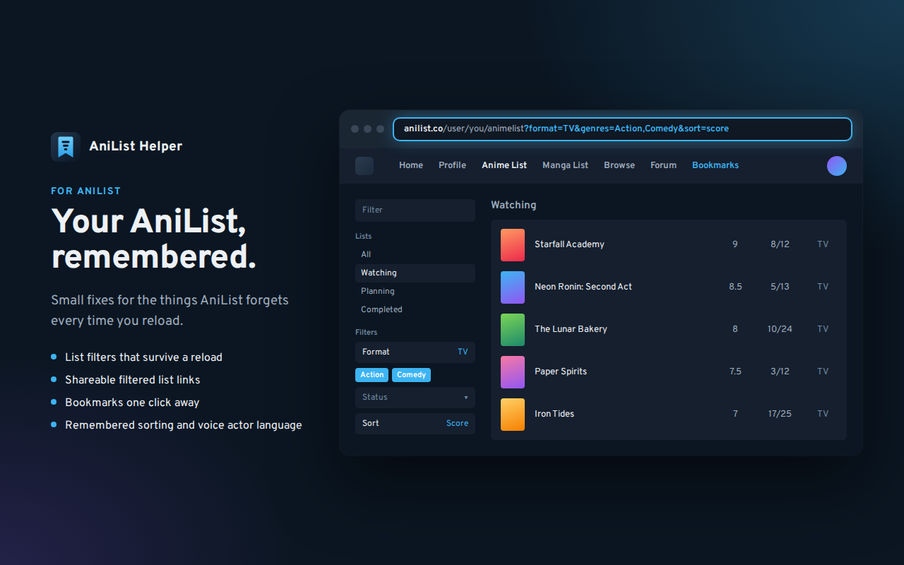

<p align="center"></p>

<h1 align="center">AniList Helper</h1>

<p align="center">
  <b>Your AniList, remembered.</b><br>
  A Chrome / Firefox extension for the things <a href="https://anilist.co">AniList</a> forgets every time you reload.
</p>

<p align="center">
  <a href="https://lepetitpaco.github.io/AniList-Helper/">Website</a> ·
  <a href="https://github.com/lepetitpaco/AniList-Helper/releases/latest">Download</a> ·
  <a href="https://lepetitpaco.github.io/AniList-Helper/privacy.html">Privacy</a>
</p>



## Features

Every feature can be turned on or off from the extension popup.

| Feature | What it does |
|---|---|
| **Persistent list filters** | The left column filters of anime/manga lists (search, format, status, genres, country, year, sort) survive a reload and are mirrored into the URL, so `…/animelist?format=TV&genres=Action,Comedy&sort=score` can be shared with other extension users. A **Reset** button next to "Filters" clears them. |
| **Bookmarks & quick links** | A one-click bookmark button next to the heart on anime, manga, character, staff and studio pages, and a **Bookmarks** menu in the top bar (Alt+B) with your bookmarks and shortcuts. On small screens, a floating button sits above AniList's menu button. Each entry point can be hidden. |
| **Remember stats sorting** | Count / Time Watched / Mean Score and the anime/characters switch, per stats page. |
| **Remember voice actor language** | The language picked on an anime's Characters tab and on character pages. |
| **Remember role sorting** | Sort order and "On my list" on staff and character pages. |

**No AniList API calls, nothing changed on your account, no tracking.** Filters and preferences live in
anilist.co's localStorage, bookmarks and settings in the extension storage. The only permission is
`storage`, plus access to `anilist.co`.

## Install

Store listings are on their way. Meanwhile, download the zip for your browser from the
[latest release](https://github.com/lepetitpaco/AniList-Helper/releases/latest):

- **Chrome / Edge / Brave**: unzip `anilist-helper-chrome.zip`, open `chrome://extensions`, turn on
  Developer mode, click "Load unpacked" and pick the unzipped folder.
- **Firefox** (128+): open `about:debugging#/runtime/this-firefox`, click "Load Temporary Add-on" and
  pick `anilist-helper-firefox.zip` (temporary add-ons are removed when Firefox closes).

## How it works

- `src/page/*.js` run in the page's world (`"world": "MAIN"`) to reach AniList's Vue 2 components
  through `element.__vue__`. `common.js` holds the shared helpers, `filters.js` handles the
  `MediaList` component (`entryFilters`, `sort`), `preferences.js` the other remembered settings.
- `src/bridge.js` (isolated world) publishes the settings on `<html data-anilist-helper>` for the page
  scripts, which can't use the storage API.
- `src/bookmarks.js` (isolated world) adds the bookmark buttons and draws the panel in a shadow root,
  using AniList's theme colors.
- `src/settings.js` declares the features and their options (`AH_FEATURES`); `popup.js` shows one
  switch per feature and one checkbox per option.
- `background.js` only exists for development: an unpacked build can be reloaded from an AniList tab
  with `document.dispatchEvent(new Event('anilist-helper:dev-reload'))`. It does nothing in store builds.

## Development

```sh
scripts/use.sh chrome    # or firefox: copies the matching manifest to manifest.json
scripts/package.sh       # packages/anilist-helper-{chrome,firefox}.zip
store/render.sh          # icons and store visuals (Docker, Playwright)
```

- Chrome: `chrome://extensions` → Developer mode → "Load unpacked" → this folder.
- Firefox: `about:debugging#/runtime/this-firefox` → "Load Temporary Add-on" → `manifest.json`
  (after `scripts/use.sh firefox`).
- Store texts: [`store/LISTING.md`](store/LISTING.md). Website: `site/`, published by
  `.github/workflows/pages.yml`.

## License

[MIT](LICENSE). AniList Helper is an independent project, not affiliated with or endorsed by AniList.
